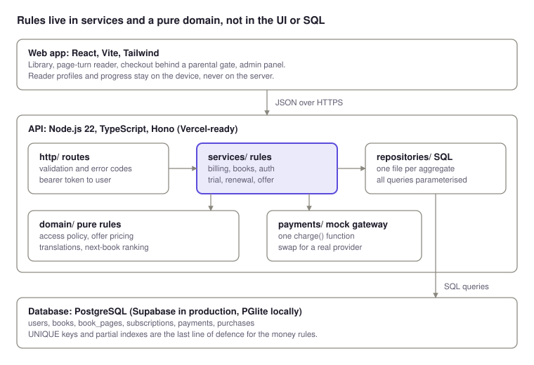

# MainStory Storybook MVP: Product Thinking and System Design

Nov 13, 2026

## At a glance

MainStory is a paid storybook library for toddlers: one subscription unlocks every book, and a one-time purchase unlocks a single book for good. This document covers the product thinking (assumptions, edge cases, trade-offs) and the system design (architecture, data model).

| Item              | Detail                                                                                              |
| ----------------- | --------------------------------------------------------------------------------------------------- |
| Estimated effort  | 12 hours (estimate)                                                                                 |
| AI used           | Claude (backend, frontend, tests, documentation) and GPT (storybook and landing-page illustrations) |
| Estimated AI cost | about US$8 (estimate)                                                                               |

**Three decisions shape everything else**

- Locked content never leaves the server, so access cannot be bypassed from the browser.
- A purchase is ownership for life and is separate from any subscription, which builds parent trust.
- Money is protected in layers: a reservation before the card is charged, idempotency keys (a unique token per purchase, so a retry is recognised) and database unique keys.

**What is built:** a Node.js API, a React web app, mock payments, a mock login, an admin panel, next-book suggestions after each story, and an interactive reader with six stories in English and Indonesian.

## Product thinking

Parents pay and children read, so the product is playful and chunky for the child and calm and clear for the parent.

### Who it is for, and why

- **Buyer: a parent aged 25 to 40 with a child aged 0 to 6.** They want screen time that feels useful, fits a bedtime routine, and costs little. This age asks for the same story again and again, so retention is natural and willingness to pay is clear.
- **Reader: a child aged 2 to 5 who is read to.** Big touch targets, little text per page, no reading ability needed. Touching stickers and answering a picture question keep them engaged, and there is no way to fail.

### Assumptions

| #   | Assumption                                                                                                                                              | Risk if wrong, or how to check                                                                                                                           |
| --- | ------------------------------------------------------------------------------------------------------------------------------------------------------- | -------------------------------------------------------------------------------------------------------------------------------------------------------- |
| 1   | The launch market is Indonesia: prices in IDR (Rp 49,000 per month, Rp 399,000 per year, books Rp 29,000 to 39,000), stories in English and Indonesian. | Prices are not validated and are the owner's call. Re-check competitor prices before quoting them.                                                       |
| 2   | One account per parent. Child profiles (up to 4 per device) live only in the browser.                                                                   | Risk: no sync between devices. Benefit: no child data on any server.                                                                                     |
| 3   | A real payment provider (Midtrans, Xendit or Stripe) can replace the mock gateway without touching the rules.                                           | Risk: recurring billing for e-wallets and QRIS is unverified. The gateway is a single function, `charge()`.                                              |
| 4   | A story is text plus an illustration per page, with up to four touchable stickers and one question.                                                     | Not yet tested with real children: do the stickers help or distract? The demo art is AI-generated.                                                       |
| 5   | A free tier turns hesitation into a purchase: one fully free book and a 2-page preview of every other book.                                             | Check the preview-to-purchase conversion rate.                                                                                                           |
| 6   | A 7-day free trial (card checked now, charged at the end) lowers the barrier to subscribe.                                                              | Competitor research found trials at Epic, Vooks and Lingokids (verify before quoting). Check the trial-to-paid rate.                                     |
| 7   | A time-limited launch offer nudges undecided parents: 30% off the first payment until 30 Nov 2026, 23:59 WIB.                                           | The percentage and end date are demo values set in configuration. The real ones are the owner's decision. Compare conversion during and after the offer. |

### Edge cases handled

Access, payment and launch-offer rules are enforced on the server and covered by 66 automated API tests. Each case below says what happens.

**Access rules, evaluated in this order**

1. Admin: reads everything, including drafts, and cannot buy.
2. Draft book: unavailable to everyone else. It answers 404, so its existence is not revealed.
3. Owned: readable forever, even if the book is later archived.
4. Archived and not owned: unavailable and not purchasable.
5. Price 0: free for everyone, guests included.
6. Active subscription, or cancelled with the paid period not yet over: readable.
7. Anything else: locked, with only the first 2 pages (the preview).

#### Content and access

| Case                          | What happens                                                                                     |
| ----------------------------- | ------------------------------------------------------------------------------------------------ |
| A locked user requests a book | The server sends only the preview pages. Locked text, stickers and answer keys are never sent.   |
| A sold book is deleted        | It is archived instead, so buyers keep it.                                                       |
| A user's role changes         | The role is read from the database on every request. Admin endpoints answer 403 to normal users. |

#### Payments

| Case                          | What happens                                                                                                                                                           |
| ----------------------------- | ---------------------------------------------------------------------------------------------------------------------------------------------------------------------- |
| Buying the same book twice    | 409 `ALREADY_OWNED`. A UNIQUE (user, book) key in the database is the last guard.                                                                                      |
| Card declined                 | 402. The payment is stored as failed and no access is granted.                                                                                                         |
| Double-click or network retry | Each purchase carries an Idempotency-Key (a unique token), so a retry returns the first result and charges once. Reusing a key for a different item is rejected (422). |
| Two buys at the same moment   | A reservation row is taken before the card is charged. The second request cannot reserve, so it cannot charge.                                                         |
| Price tampering               | The price is always read from the database, never from the client.                                                                                                     |

#### Subscriptions and trial

| Case                             | What happens                                                                                                                                                                                                                                                                   |
| -------------------------------- | ------------------------------------------------------------------------------------------------------------------------------------------------------------------------------------------------------------------------------------------------------------------------------ |
| Subscribing while already active | 409 `ALREADY_SUBSCRIBED`.                                                                                                                                                                                                                                                      |
| Cancelling                       | Access continues to the end of the paid period. No refund for the unused part. It can be resumed.                                                                                                                                                                              |
| Renewal with no scheduler        | Renewal runs when the subscription is next read, with a compare-and-set update (it only succeeds if nobody else changed the row first), so it happens once even under concurrent requests. After a long lapse the new period starts today with one charge, never back-charged. |
| A second trial                   | One trial per account. Cancelling during the trial charges nothing.                                                                                                                                                                                                            |

#### Launch offer

| Case                                          | What happens                                                                                                                      |
| --------------------------------------------- | --------------------------------------------------------------------------------------------------------------------------------- |
| The offer ends while a parent is checking out | Checkout sends the price on screen. If the server's price differs it answers 409 `PRICE_CHANGED` before charging anything.        |
| A trial started during the offer              | The discount is locked in and applied once, to the first charge at the end of the trial. Later renewals are at the regular price. |
| The device clock is wrong                     | The countdown uses the server's clock and a fixed end instant, so it cannot promise time the server will not honour.              |

**Grown-ups only.** Every checkout in the web app starts with a parental gate (a multiplication question). It is a safeguard in the interface, not a server rule.

### Trade-offs

Where revenue and simplicity pulled apart, the product chose parent trust and a small, testable system. The cost of each choice is named.

#### Product trade-offs

| Decision                                                    | Instead of                            | Gain                                                                   | Cost                                                           |
| ----------------------------------------------------------- | ------------------------------------- | ---------------------------------------------------------------------- | -------------------------------------------------------------- |
| A purchased book is owned for life                          | Access only while subscribed          | Parent trust: a small purchase never feels rented                      | Some would-be subscribers buy single books instead             |
| Subscribers can still buy a book                            | Hiding the buy button from them       | A gentle upsell that protects a favourite if they stop subscribing     | Some overlap with the subscription                             |
| Cancelling keeps access to the end of the period, no refund | Cutting access at once                | Fair, standard, easy to explain                                        | No refund for the unused part                                  |
| The launch countdown is for parents, with a real end time   | A timer that resets for every visitor | Honest urgency, no dark pattern, never shown in the reader             | The offer has a hard end that someone must manage              |
| No points, streaks or timers in the reader                  | Typical engagement mechanics          | Calm for toddlers, and a finished book earns a puzzle of its own story | Fewer hooks for daily return                                   |
| Child profiles stay on the device                           | Profiles stored on the server         | No child data on any server                                            | No sync across devices                                         |
| Next-book suggestions include locked books                  | Only readable books                   | Requested by the owner: paid books appear at the natural moment        | Risk of pester power, so payment sits behind the parental gate |

#### Engineering trade-offs

| Decision                                              | Instead of                          | Gain                                                                                 | Cost                                                     |
| ----------------------------------------------------- | ----------------------------------- | ------------------------------------------------------------------------------------ | -------------------------------------------------------- |
| Content is gated on the server, and drafts answer 404 | Hiding content in the UI only       | Locked text never reaches the browser, and a draft's existence is not leaked         | Every read goes through the API                          |
| Email-only mock login                                 | Passwords or one-time codes         | Matches the brief, and auth sits behind one service that a real provider can replace | Anyone who knows the admin email is admin, so demo only  |
| SQLite (libSQL) with plain SQL, no ORM                | Postgres with an ORM and migrations | No setup locally, and Turso in production                                            | No migration runner, only an idempotent schema bootstrap |
| Renewal runs when the subscription is read            | A scheduler or cron job             | Simple, and correct under concurrent requests                                        | A real provider's webhooks are needed in production      |
| A mock gateway behind one function                    | Integrating a provider now          | Fast to build and test, and swappable without touching the rules                     | No real recurring billing, refunds or webhooks yet       |

## System design

### Architecture overview

The web app talks only to the API, and the API enforces every rule about access and money. Inside the API, requests flow one way: routes, then services, then SQL. The pure rules sit to the side so they can be tested without a database.

The highlighted services layer holds the business rules and calls the pure domain functions, the mock payment gateway and the repositories. Swapping in a real payment provider changes only the payments box.

The "what to read next" feature follows the same path. The route `GET /v1/books/:key/next` validates the request, the books service filters out the current book, drafts and anything the child already finished, and `domain/recommend.ts` ranks what is left: books for the same age first, then the closest age, then ones the child can open right now, then catalogue order. Locked books are included on purpose, because tapping one opens the payment flow.

**Life of a purchase**

1. The route checks the login and validates the request.
2. The service applies the access rules: the book must be published, not free, and not already owned.
3. It reserves a pending payment row. A second request for the same item cannot reserve one.
4. It checks the rules again in case something changed meanwhile, and cancels the reservation if so.
5. It charges the card through the gateway. A decline marks the payment as failed.
6. One atomic database batch marks the payment as succeeded and grants the book, so there is never a charge without access.
7. The API returns the updated account, including the new purchase.

### Data model

Six tables hold everything. Unique keys and partial indexes are the last line of defence for the money rules, behind the checks in code.

How they connect: a user has at most one subscription, and any number of payments and purchases. A purchase ties together one user, one book and the payment that paid for it. A book has many pages.

| Table           | Key columns                                                                                                               | Rules it enforces                                                                                                                                                                                             |
| --------------- | ------------------------------------------------------------------------------------------------------------------------- | ------------------------------------------------------------------------------------------------------------------------------------------------------------------------------------------------------------- |
| `users`         | `id`, `email` (unique), `role` (user or admin)                                                                            | The role is checked against this table on every request.                                                                                                                                                      |
| `books`         | `slug` (unique), `price` (0 or more, 0 means free), `status` (draft, published, archived), `preview_pages`, `i18n` (JSON) | Status decides who can see the book. A language is offered only when the title and every page are translated.                                                                                                 |
| `book_pages`    | (`book_id`, `position`) as primary key, `text`, `image_url`, `activity` (JSON), `i18n` (JSON)                             | Deleted with its book. Stickers and the question travel with the page, so they are gated exactly like its text.                                                                                               |
| `subscriptions` | `user_id` (unique), `plan_id`, `current_period_start` and `end`, `cancel_at_period_end`, `trial`, `promo_percent`         | One row per user. Renewals update it and history lives in payments. `promo_percent` holds the launch-offer discount locked in at signup until the first paid charge.                                          |
| `payments`      | `kind` (subscription or book), `ref_id`, `amount`, `status` (pending, succeeded, failed), `idempotency_key`, `last4`      | Two uniqueness rules apply to live rows: one per idempotency key (the token that lets a retry be recognised), and at most one pending payment per user and item. Only the last 4 digits of a card are stored. |
| `purchases`     | `user_id`, `book_id`, `payment_id`, `amount`                                                                              | UNIQUE (`user_id`, `book_id`): a book can be granted once per user.                                                                                                                                           |

Money is stored as whole IDR integers. Plans (monthly and yearly) are configuration, not table rows, and the launch offer is configuration too (a percentage and an end instant).
